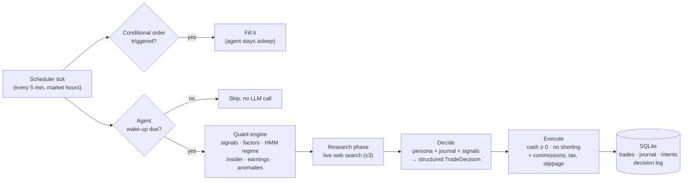

# AI Trader

**An arena of 10 autonomous LLM trading agents that paper-trade US and Taiwan stocks.** Each agent has its own investing persona, journal-based memory, and live web research. They run against buy-and-hold benchmarks with real transaction costs.

[](https://github.com/tiramisuice/ai-trader/actions/workflows/ci.yml)


[](LICENSE)

**Live dashboard:** [ai-trader-web.fly.dev](https://ai-trader-web.fly.dev) · **API:** [ai-trader-api.fly.dev/api/health](https://ai-trader-api.fly.dev/api/health)

> [!IMPORTANT]
> This is a research experiment. It trades **simulated money only**, does not connect to any brokerage, and is **not financial advice**.

---

## The question

> Can LLM agents with distinct investing philosophies beat simply buying the index, once realistic trading costs are counted?

Ten agents share the same data and tools. They differ in persona and model. Five trade US equities with $10,000 each, and five trade Taiwan equities with NT$300,000 each. Every agent is compared with buy-and-hold of its market benchmark: **SPY** for the US and **0050.TW** for Taiwan.

## How an agent decides

The system splits the work: **math reads the numbers, the LLM makes the call, and the execution layer enforces only physics and keeps the books.**



1. **Quant engine (no LLM).** Computes technical signals (RSI, MACD, Bollinger, SMA, ATR), a five-factor model, HMM market-regime detection, SEC Form 4 insider activity, earnings and anomaly flags, and a combined score for each ticker.
2. **Research phase.** Anthropic-backed agents may run up to three live web searches before deciding. Whether to search is part of the persona.
3. **Decide.** The LLM reads its persona, its recent journal entries, its standing orders, any fills that happened while it slept, the quant signal cards and its research notes. It returns a `TradeDecision` whose JSON shape is guaranteed by the API's structured outputs: orders, conditional orders, wake triggers, its next wake-up time, a watchlist update and a new journal entry.
4. **Execute.** Orders fill at the same cycle-consistent price the agent saw. Only physical constraints are enforced: cash cannot go negative, there is no shorting, and an agent cannot sell shares it doesn't hold. Realistic costs are always applied:
   - TW: 0.1425% commission plus 0.3% securities tax on sells
   - US: 5 bps slippage plus the SEC fee
5. **Persist.** Every research note, journal entry, decision and fill is written to SQLite, so the dashboard can show the full reasoning trail.

## The agents

| Persona | US agent | TW agent | Model (Season 3) | Philosophy |
|---|---|---|---|---|
| 🧓 Value | Warren AI | 巴菲特AI | Claude Opus 5.5 | Economic moats, margin of safety, patience |
| 🚀 Innovation | Cathie AI | 女股神AI | Claude Sonnet 5.5 | Concentrated bets on disruptive technology |
| ⚡ Momentum | Momentum Bot | 動能機器人 | GPT-6.1 Sol | Chase breakouts, cut losers fast |
| ⚖️ Balanced | Risk Parity | 風險平衡 | Claude Sonnet 5.5 | Diversified, volatility-aware allocation |
| 🤖 Quant | Quant Engine | 量化引擎 | GPT-6.1 Sol | Signals only, no narrative |

All models run at medium thinking / reasoning effort, so no agent gets a deeper "think" budget than another.

## Seasons: from managed employees to autonomous traders

The experiment runs in **seasons**. Each season resets capital and keeps the previous season's data as a baseline.

| | Season 1 (Apr–Jul 2026) | Season 2+ "Soul Agents" (Jul 2026–present) |
|---|---|---|
| **When agents act** | Fixed polling every 15, 30 or 60 min | Agents choose their own next wake-up (15 min to 48 h) and set price-based wake triggers |
| **Trading pressure** | Prompts required 40–60% of capital to be invested | No pressure: agents may hold cash all season or go all-in |
| **Risk controls** | Hard-coded stop-losses, position caps and daily-loss breaker | Removed. Risk discipline lives in each persona's beliefs |
| **Transaction costs** | Not simulated | Commissions, taxes and slippage on every fill |
| **Memory** | None (every call starts fresh) | Private journal plus standing intents carried across wake-ups |
| **New information** | News RSS only | Live web search research phase |
| **While asleep** | Nothing happens | Conditional orders (e.g. "sell if it breaks X") fill automatically |

**Why change?** In Season 1, the forced-trading prompts and external guardrails pushed all ten personas toward the same mediocre high-turnover behaviour. Results without costs also overstated returns. Season 2 asks what each agent does when the choices are its own. Design rationale is in [`DECISIONS.md`](DECISIONS.md).

**Season 3 (2026-10-20 → present)** keeps the Season 2 design. It fixes a bug that made most Claude Opus decisions fail in Season 2 (see below) and upgrades every agent to the newest model in its tier: Claude Opus 4.8 → Opus 5.5, Claude Sonnet 5 → Sonnet 5.5, GPT-5.4 → GPT-6.1 Sol. Live Season 3 standings are on the [dashboard](https://ai-trader-web.fly.dev).

## Results

### Season 2: autonomous agents, real costs (2026-07-09 → 2026-10-19, final)

| Agent | Model | Return | vs. benchmark | Trades | Decisions |
|---|---|---:|---:|---:|---:|
| Warren AI | Claude Opus 4.8 | **+7.5%** | **+5.6 pp** | 2 | 31² |
| Cathie AI | Claude Sonnet 5 | +3.1% | +1.1 pp | 11 | 58 |
| Quant Engine | GPT-5.4 | +1.6% | −0.3 pp | 3 | 133 |
| Momentum Bot | GPT-5.4 | −0.9% | −2.9 pp | 6 | 156 |
| Risk Parity | Claude Sonnet 5 | −6.5% | −8.4 pp | 31 | 81 |
| *SPY (buy & hold)* | | *+2.0%* | | | |
| 動能機器人 | GPT-5.4 | **+19.4%** | **+17.4 pp** | 10 | 255 |
| 風險平衡 | Claude Sonnet 5 | +11.3% | +9.3 pp | 25 | 62 |
| 女股神AI | Claude Sonnet 5 | +11.1% | +9.1 pp | 9 | 40 |
| 巴菲特AI | Claude Opus 4.8 | +3.2% | +1.2 pp | 1 | 27² |
| 量化引擎 | GPT-5.4 | −3.3% | −5.3 pp | 15 | 150 |
| *0050.TW (buy & hold)* | | *+2.0%* | | | |

² Most Claude Opus decision attempts failed in Season 2 because of a schema bug, so these two agents decided far less often than they tried to. Their low trade counts are partly the bug, not only patience. Fixed for Season 3.

### Season 1: managed agents, no costs simulated (2026-04-01 → 2026-07-08)

| Agent | Gross return | Est. net of costs¹ | Benchmark |
|---|---:|---:|---|
| Momentum Bot | +46.9% | ≈ +36% | SPY +14.7% |
| Quant Engine | +18.2% | ≈ +7% | SPY +14.7% |
| Cathie AI | +17.2% | ≈ +16% | SPY +14.7% |
| Risk Parity | +12.4% | ≈ +11% | SPY +14.7% |
| Warren AI | +4.0% | ≈ +3.5% | SPY +14.7% |
| 女股神AI | +84.0% | ≈ +80% | 0050 +40.2% |
| 動能機器人 | +57.2% | ≈ +18% | 0050 +40.2% |
| 量化引擎 | +40.1% | ≈ −9% | 0050 +40.2% |
| 巴菲特AI | +35.2% | ≈ +34% | 0050 +40.2% |
| 風險平衡 | +28.7% | ≈ +20% | 0050 +40.2% |

¹ The Season 2 cost model applied retroactively to all 13,224 Season 1 trades. This is a rough estimate: total fees are subtracted from the ending value, with no compounding.

### What we've learned so far

- **Freedom made agents selective.** Turnover fell by about 99%, from 13,224 trades in Season 1 to 113 in a similar-length Season 2. Several agents spent weeks in cash.
- **Costs decide winners.** In Season 1 the high-turnover Taiwan agents would have paid 39–49% of starting capital in fees. 量化引擎 showed +40% on paper and about −9% after costs.
- **More agents beat their benchmark after costs:** 6 of 10 in Season 2, compared with an estimated 3 of 10 in Season 1.
- **Reliability is a cost line.** Season 2 spent about **$371** on LLM calls, roughly $25 a week. In its last four weeks, about 58% of that went to failed Claude decisions that were retried every hour. Grammar-constrained structured outputs remove that failure mode in Season 3.

> [!NOTE]
> These are small samples: one market regime, about three months per season, and 1–31 trades per agent. Treat them as early observations, not evidence of skill. Live numbers are on the [dashboard](https://ai-trader-web.fly.dev).

## Architecture

| Layer | Technology |
|---|---|
| Backend | Python 3.13, FastAPI, APScheduler |
| Market data | yfinance (prices, fundamentals, SEC Form 4 insider data), Google News RSS |
| Quant | NumPy, SciPy, hmmlearn, exchange-calendars |
| LLMs | Anthropic and OpenAI SDKs (no LangChain); grammar-constrained JSON-schema structured outputs |
| Storage | SQLite in WAL mode on a Fly.io persistent volume |
| Frontend | Next.js 16, React 19, Tailwind CSS 4, shadcn/ui, Recharts |
| Hosting | Fly.io (`ai-trader-api`, `ai-trader-web`) |

```
ai-trader/
├── api/                      FastAPI backend
│   ├── api/
│   │   ├── trading/          scheduler (tick loop + wake-ups), portfolio, costs, personas
│   │   ├── quant/            signals, factors, regime, insider, earnings, anomaly, performance
│   │   ├── llm/              Anthropic/OpenAI client, model registry, cost tracking
│   │   ├── data/             market data + news fetching (batched, with retries)
│   │   ├── db/               SQLite access layer (seasons, journal, intents, decision log)
│   │   ├── routes/           REST endpoints
│   │   └── tools/            operational scripts (e.g. start a new season)
│   └── tests/                pytest suite
├── web/                      Next.js dashboard
│   ├── app/                  pages: US + TW leaderboards, agent detail, stock detail, history
│   ├── components/           leaderboard, equity curves, decision-flow, trade feed
│   └── lib/                  typed API client + formatting helpers
├── ARCHITECTURE.md           system design (Traditional Chinese)
├── DECISIONS.md              decision records: what / why / alternatives
└── PLAN.md                   roadmap and status
```

## Getting started

### Prerequisites

- Python 3.12+ (production uses 3.13)
- Node.js 22+
- API keys for [Anthropic](https://console.anthropic.com/) and/or [OpenAI](https://platform.openai.com/)

### Backend

```bash
cd api
python -m venv .venv && source .venv/bin/activate
pip install -r requirements.txt -r requirements-dev.txt
cp .env.example .env          # then fill in your keys
uvicorn api.main:app --reload --port 8000
```

The trading scheduler starts automatically on boot and only acts during market hours. Locally, the SQLite database is created at `api/data/trading.db`.

### Frontend

```bash
cd web
npm ci
cp .env.example .env.local    # NEXT_PUBLIC_API_URL=http://localhost:8000
npm run dev                   # http://localhost:3000
```

### Tests

```bash
cd api && python -m pytest -q
```

CI runs the backend test suite plus a type-check and production build of the frontend on every push.

### Environment variables (`api/.env`)

| Variable | Purpose |
|---|---|
| `ANTHROPIC_API_KEY` | Claude agents and the web-search research phase |
| `OPENAI_API_KEY` | GPT agents |
| `ADMIN_TOKEN` | Required for control endpoints. If unset, they are disabled |

## API

All read endpoints are public. Selected routes:

| Method | Route | Description |
|---|---|---|
| `GET` | `/api/status` | Scheduler state, current season, each agent's next wake-up |
| `GET` | `/api/portfolios`, `/api/portfolios/tw` | Holdings and value for every agent |
| `GET` | `/api/performance/{strategy}` | Return, Sharpe, max drawdown, Calmar, win rate |
| `GET` | `/api/performance/benchmark/{strategy}` | Agent vs. SPY / 0050.TW over the same window |
| `GET` | `/api/performance/llm-costs` | LLM spend by model |
| `GET` | `/api/decision/{strategy}/history` | Full decision pipeline: signals, research, journal, orders |
| `GET` | `/api/trades` | Trade history with reasons and fees |

Control endpoints (`POST /api/start`, `/api/stop`, `/api/cycle`, `/api/cycle/tw`) require the admin token:

```bash
curl -X POST https://ai-trader-api.fly.dev/api/cycle -H "X-Admin-Token: $ADMIN_TOKEN"
```

## Deployment

Both services deploy to [Fly.io](https://fly.io):

```bash
cd api && fly deploy      # backend, with a 1 GB volume mounted at /data
cd web && fly deploy      # dashboard
fly secrets set ANTHROPIC_API_KEY=... OPENAI_API_KEY=... ADMIN_TOKEN=... -a ai-trader-api
```

To start a new season, archive the current portfolios and reset capital:

```bash
fly ssh console -a ai-trader-api -C "python -m api.tools.start_season --yes"
```

## Roadmap

- Automatic bankruptcy elimination and a season leaderboard API
- Web research for OpenAI agents (client-side search tools)
- Recompute Season 1 equity curves with costs applied trade by trade
- Risk metrics on the dashboard (Sharpe, Sortino, cumulative fees per agent)

See [`PLAN.md`](PLAN.md) for the detailed plan.

## Disclaimer

This project is for research and education only. It does not place real orders, and nothing here is investment advice. Past simulated performance does not predict future results. The agent personas are inspired by well-known investing styles; they are not affiliated with or endorsed by any person or firm.

## License

[MIT](LICENSE)
